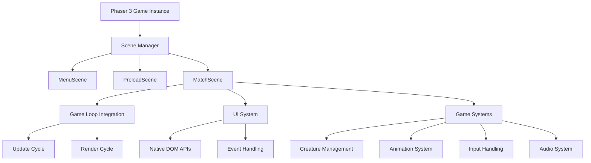

# Design Document

## Overview

This design outlines the completion of the Phaser 3 migration for MythosTactica, focusing on removing jQuery dependencies, implementing proper game loop integration, and ensuring all game systems work seamlessly with Phaser 3's architecture. The migration builds upon the existing foundation where basic scene structure and asset loading are already implemented.

## Architecture

### Current State Analysis

The game currently has:
- ✅ Basic Phaser 3 setup with scene structure (MenuScene, PreloadScene, MatchScene)
- ✅ Asset loading system updated for Phaser 3
- ✅ jQuery replacement utilities started in `src/script.ts`
- ✅ UI system partially converted to TypeScript (`src/ui/interface.ts`)
- 🚧 Game loop methods (`phaserUpdate`, `phaserRender`) are stubbed but not implemented
- 🚧 Some jQuery dependencies may still exist in UI components

### Target Architecture



## Components and Interfaces

### 1. jQuery Replacement System

**Location**: `src/script.ts` (already partially implemented)

**Current Implementation**: The `$` utility object provides basic DOM manipulation methods.

**Design Enhancements**:
- Extend existing utility functions to cover all jQuery usage patterns
- Add form handling utilities for complex UI interactions
- Implement event delegation for dynamic content
- Add CSS manipulation helpers for animations and styling

**Interface**:
```typescript
interface DOMUtilities {
  // Element selection and manipulation
  get(selector: string): HTMLElement | null;
  getAll(selector: string): NodeListOf<Element>;
  hide(element: HTMLElement | null): void;
  show(element: HTMLElement | null): void;
  addClass(element: HTMLElement | null, className: string): void;
  removeClass(element: HTMLElement | null, className: string): void;
  
  // Event handling
  on(selector: string | HTMLElement, event: string, handler: EventListener): void;
  off(selector: string | HTMLElement, event: string, handler?: EventListener): void;
  
  // Form utilities
  getFormData(form: HTMLFormElement): { [key: string]: string };
  getValue(element: HTMLInputElement | null): string;
  setValue(element: HTMLInputElement | null, value: string): void;
}
```

### 2. Game Loop Integration

**Location**: `src/game.ts` methods `phaserUpdate()` and `phaserRender()`

**Current State**: Methods exist but are empty stubs.

**Design**:
- `phaserUpdate()`: Handle game state updates, creature AI, turn management
- `phaserRender()`: Handle visual updates, animations, UI state synchronization
- Integration with MatchScene's update cycle for proper timing

**Implementation Strategy**:
```typescript
class Game {
  phaserUpdate() {
    if (this.gameState !== 'playing') return;
    
    // Update game systems
    this.playerManager.update();
    this.creatureManager.update();
    this.effectManager.update();
    
    // Handle turn-based logic
    if (this.turnThrottle) {
      this.handleTurnTransition();
    }
  }
  
  phaserRender() {
    // Update creature visual states
    this.creatureManager.creatures.forEach(creature => {
      if (creature && creature.sprite) {
        creature.updateVisualState();
      }
    });
    
    // Update UI elements
    if (this.UI) {
      this.UI.updateDisplay();
    }
  }
}
```

### 3. Sprite and Animation System

**Location**: `src/models/Creature.ts`, `src/animations.ts`

**Design**:
- Convert creature sprites to use Phaser 3 sprite objects
- Implement animation system using Phaser 3's animation manager
- Update hex grid rendering to use Phaser 3 graphics objects

**Sprite Management**:
```typescript
interface CreatureSprite {
  phaserSprite: Phaser.GameObjects.Sprite;
  animations: Phaser.Animations.Animation[];
  updatePosition(x: number, y: number): void;
  playAnimation(animationKey: string): void;
}
```

### 4. Input System Migration

**Location**: New `src/input/InputManager.ts`

**Design**:
- Centralized input handling using Phaser 3's input system
- Support for mouse, keyboard, and touch inputs
- Hex grid coordinate detection
- Input state management for different game modes

**Interface**:
```typescript
interface InputManager {
  initialize(scene: Phaser.Scene): void;
  handleHexClick(x: number, y: number): void;
  handleKeyboardInput(key: string): void;
  enableInput(): void;
  disableInput(): void;
}
```

### 5. Audio System Integration

**Location**: `src/sound/soundsys.ts` (already exists)

**Design**:
- Integrate existing SoundSys with Phaser 3's audio system
- Ensure compatibility between custom audio handling and Phaser 3
- Maintain existing audio configuration and volume controls

## Data Models

### Game State Management

The game state flow remains the same but with proper integration:

```typescript
type GameState = 'initialized' | 'loading' | 'loaded' | 'playing' | 'ended';

interface GameStateManager {
  currentState: GameState;
  transitionTo(newState: GameState): void;
  canTransition(from: GameState, to: GameState): boolean;
}
```

### Scene Data Passing

Data flow between scenes:

```typescript
interface SceneData {
  game: Game;
  playerMode?: number;
  config?: GameConfig;
}
```

### UI State Management

```typescript
interface UIState {
  dashOpen: boolean;
  selectedCreature: string;
  selectedAbility: number;
  activePlayer: number;
}
```

## Error Handling

### jQuery Migration Errors

**Strategy**: Gradual replacement with fallback detection
- Detect remaining jQuery usage through runtime checks
- Provide clear error messages when jQuery methods are called
- Implement compatibility shims for critical functionality during transition

### Game Loop Errors

**Strategy**: Defensive programming with state validation
- Validate game state before each update cycle
- Handle missing or invalid creature data gracefully
- Implement error recovery for animation and rendering failures

### Input System Errors

**Strategy**: Input validation and sanitization
- Validate hex coordinates before processing clicks
- Handle edge cases for touch input on mobile devices
- Provide fallback input methods if primary input fails

## Testing Strategy

### Unit Testing

**jQuery Replacement**:
- Test each utility function for DOM manipulation
- Verify event handling works correctly
- Test form data extraction and validation

**Game Loop**:
- Test update cycle with various game states
- Verify render cycle doesn't cause performance issues
- Test turn transition logic

### Integration Testing

**Scene Transitions**:
- Test data passing between scenes
- Verify UI state persistence across scene changes
- Test game initialization and cleanup

**Input System**:
- Test mouse, keyboard, and touch input handling
- Verify hex grid coordinate detection accuracy
- Test input state management during different game phases

### Performance Testing

**Benchmarks**:
- Measure frame rate during gameplay (target: 60fps)
- Monitor memory usage during long gaming sessions
- Test asset loading times with Phaser 3 system

**Regression Testing**:
- Verify all existing UI interactions work identically
- Test combat system functionality
- Verify multiplayer synchronization
- Test save/load system compatibility

## Implementation Phases

### Phase 1: jQuery Removal (High Priority)
- Complete the jQuery replacement utilities in `src/script.ts`
- Update any remaining jQuery usage in UI components
- Test all UI interactions for functionality parity

### Phase 2: Game Loop Implementation (High Priority)
- Implement `phaserUpdate()` method with game logic
- Implement `phaserRender()` method with visual updates
- Integrate with MatchScene's update cycle
- Test turn-based game flow

### Phase 3: Sprite System Migration (Medium Priority)
- Convert creature sprites to Phaser 3 objects
- Implement animation system using Phaser 3
- Update hex grid rendering
- Test visual consistency and performance

### Phase 4: Input System Migration (Medium Priority)
- Create centralized InputManager
- Implement hex grid click detection
- Add keyboard and touch input support
- Test input responsiveness and accuracy

### Phase 5: Audio System Integration (Low Priority)
- Ensure SoundSys works with Phaser 3
- Test audio loading and playback
- Verify volume controls and settings persistence

### Phase 6: Testing and Optimization (Ongoing)
- Comprehensive regression testing
- Performance optimization
- Bug fixes and polish

## Technical Considerations

### Backward Compatibility

- Maintain compatibility with existing save files
- Preserve all existing game mechanics and UI behavior
- Ensure multiplayer protocol remains unchanged

### Performance Optimization

- Leverage Phaser 3's built-in optimizations (object pooling, batch rendering)
- Minimize DOM manipulation during gameplay
- Use efficient event handling patterns

### Mobile Support

- Ensure touch input works correctly on mobile devices
- Maintain responsive design for different screen sizes
- Test performance on lower-end mobile devices

### Development Workflow

- Implement changes incrementally to avoid breaking existing functionality
- Use feature flags to enable/disable new implementations during development
- Maintain comprehensive test coverage throughout the migration